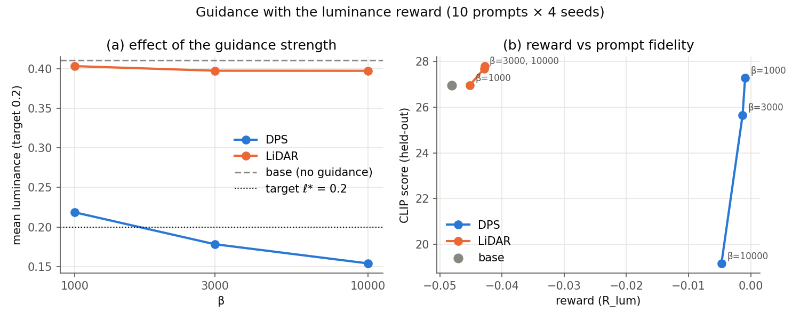
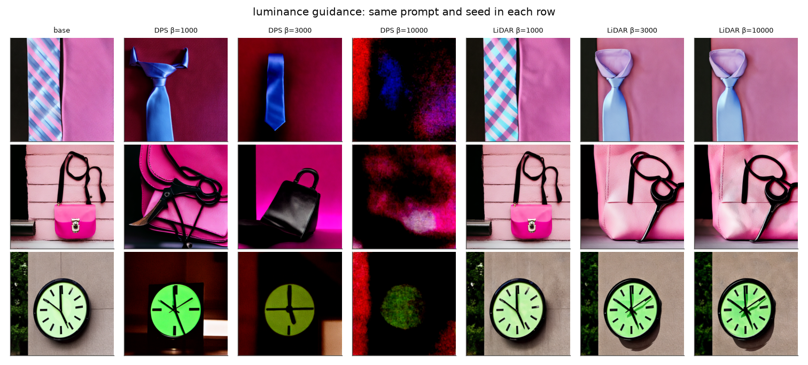
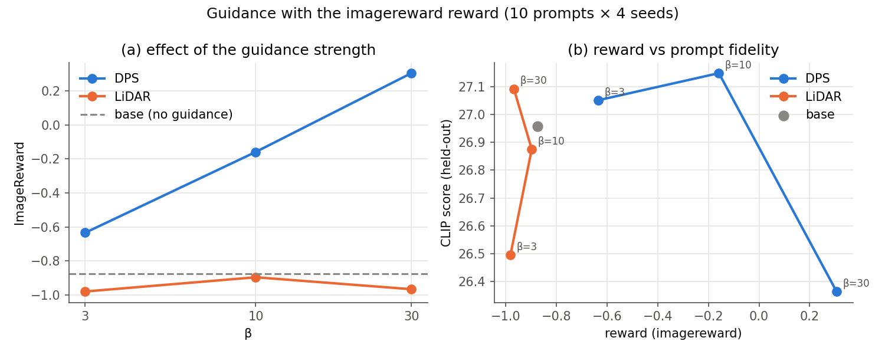
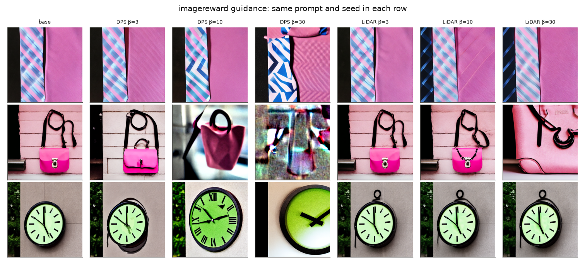

# Test-time guidance of Stable Diffusion 1.5 with reward gradients

**Question.** Given a pretrained diffusion model p and a differentiable reward R, can we use ∇R to sample from
π(x₀) ∝ p(x₀)·exp(β R(x₀)), and how does that compare with LiDAR, which only uses reward *values*?

**Short answer.**
1. A simple gradient method (DPS: differentiate the Tweedie approximation of the expected future reward) steers
   generation far more effectively than LiDAR: it reaches the luminance target (0.219 for a target of 0.2, from 0.411)
   and raises ImageReward from −0.87 to +0.31, where LiDAR barely moves either reward.
2. DPS does **not** sample π: past a moderate β it overshoots the target and its reward *decreases* with β, which is
   impossible under π. At large β the images leave the data manifold (luminance) or exploit the reward model
   (ImageReward), and the held-out CLIP score detects it.
3. LiDAR fails for a structural reason that we measured: in the 16 384-dimensional latent space its Gaussian weights
   collapse onto a single lookahead sample after the first step (effective sample size ≈ 1), so its guidance term is
   exactly zero for 49 of the 50 steps.

The scope is deliberately small (2 methods, 2 rewards, 10 prompts × 4 seeds, 3 values of β each); every
choice below is justified and every number can be reproduced with one command (see `README.md`).

---

## 1. Background: what has to be estimated

Following the primer, the target is π ∝ p·e^{βR}, the solution of max_q E_q[R] − (1/β) KL(q‖p). Its noised marginals
are πₜ ∝ pₜ·hₜ with the tilt hₜ(xₜ) = E_{p(x₀|xₜ)}[e^{βR(x₀)}], so

    ∇log πₜ(xₜ) = ∇log pₜ(xₜ) + ∇log hₜ(xₜ).

The pretrained network gives the first term (sθ = −ε/σₜ). Running the unchanged DDIM sampler with the score of πₜ
generates samples of π, which in noise-prediction form means replacing, at every step,

    ε  by  ε̃ = ε − σₜ · ∇log hₜ(xₜ).

**Every method in this report is therefore just an estimator of ∇log hₜ**, plugged into the same sampler at the
same place. This keeps the comparison fair: the sampler, the prompts, the seeds and the initial noise x_T are
identical across methods, so each guided image is paired with a base image.

## 2. Methods

### 2.1 DPS: gradient of the Tweedie approximation (uses ∇R)

The Tweedie approximation (primer eq. 14) replaces the posterior p(x₀|xₜ) by a point mass at its mean
x̄₀(xₜ) = (xₜ − σₜ ε)/αₜ, so log hₜ(xₜ) ≈ β R(D(x̄₀(xₜ))). We differentiate this approximation:

    ∇log hₜ(xₜ) ≈ β · ∇ₓₜ R(D(x̄₀(xₜ))).

At every step: compute ε with gradients enabled, form x̄₀, decode with the VAE, evaluate R, and back-propagate
R → reward → VAE → x̄₀ → UNet → xₜ (one backward pass per step for the whole batch). The gradient is not propagated
across steps.

*Why this method.* It is the most direct way to use ∇R in the framework of the primer: it is the gradient of the
standard cheap estimate of the EFR, it has no hyperparameter other than β, and its known weakness (the point-mass
approximation, worst when x̄₀ is blurry and β is large) gives a clear prediction to test.

### 2.2 LiDAR: lookahead samples (reward values only)

Implemented from primer eq. 16–17. For each prompt we draw n = 16 lookahead samples x̂ⁱ ~ p with a cheap 10-step
DDIM sampler, compute their rewards Rᵢ once, and at every step use

    wᵢ ∝ exp(−‖xₜ − αₜ x̂ⁱ‖² / 2σₜ²),   wᵢᴿ ∝ wᵢ e^{βRᵢ},   ∇log hₜ = (αₜ/σₜ²) Σᵢ (wᵢᴿ − wᵢ) x̂ⁱ.

No backward pass is needed. The lookahead samples are shared by the 4 seeds of a prompt, and their cost is included
in the reported time.

### 2.3 Implementation and validation

Everything is implemented from scratch around `diffusers` (no guidance library): a 5-line DDIM loop
(`tg/ddim.py`) with a single entry point `guidance.eps(...)`, an SD1.5 wrapper (`tg/sd.py`), and the rewards
(`tg/rewards.py`). Before running any guidance we checked (`scripts/check_setup.py`):

| Check | Result |
|---|---|
| Our DDIM loop vs the `diffusers` pipeline (same prompt, same x_T) | mean pixel difference 0.006 on [0, 1] (bf16 rounding) |
| Our differentiable ImageReward vs the official PIL-based score | 0.668 vs 0.665 |
| ∇R reaches the latent through the VAE | finite, non-zero for both rewards |

ImageReward's official `score` goes through PIL and is not differentiable; we re-implemented its forward pass in torch
(resize, CLIP normalisation, BLIP encoders, MLP). Numerical choices: UNet in bf16 (same exponent range as fp32, so
small gradients do not underflow as they can in fp16), VAE in fp32 since every reward gradient flows through it.

## 3. Experimental setup

| | Choice | Justification |
|---|---|---|
| Model | SD1.5, DDIM 50 steps, η = 0, CFG 7.5, 512×512 | as specified |
| Prompts | first 10 GenEval prompts of `prompts.txt`, seeds 0–3 (40 images per configuration) | 4–5 h budget; every configuration costs ≤ 2.5 min |
| Rewards | luminance R = −(ℓ̄ − 0.2)² ; ImageReward | one simple, interpretable reward and one learned reward |
| β | luminance {10³, 3·10³, 10⁴}; ImageReward {3, 10, 30} | see below |
| Held-out metric | CLIP score (ViT-L/14, 100·cos) | measures prompt fidelity, never used for guidance |
| Other measures | both rewards on every image, mean pixel distance to the paired base image, wall-clock time per image | cross-effects, distance from p, cost |

**Luminance target.** The base images have mean luminance 0.41; a target of 0.2 (dark images) is far enough to make
the effect of guidance unambiguous.

**Choice of β.** β has no absolute meaning: it multiplies R, whose scale depends on the reward. The guidance changes
ε by σₜβ∇R, which must be comparable to ‖ε‖ ≈ √16384 ≈ 128 to have an effect. At a base image we measured
‖∇R‖ ≈ 2·10⁻³ for luminance and ≈ 0.74 for ImageReward, hence β ~ 10³–10⁴ for luminance and ~ 10 for ImageReward.
Both methods use the same β, so they target the same π.

**HPSv2** was left out: its package is unmaintained (like ImageReward's, which needed pinned library versions),
and one well-understood held-out metric was enough for the argument.

## 4. Results

All numbers are means over 10 prompts × 4 seeds. With 40 images, differences in CLIP score below about one point
should not be considered significant.

### 4.1 Luminance (target ℓ* = 0.2)

| Method | β | mean luminance | R_lum | CLIP | ImageReward | dist. to base | time / image |
|---|---|---|---|---|---|---|---|
| base | – | 0.411 | −0.048 | 26.96 | −0.87 | 0 | 0.47 s |
| DPS | 10³ | **0.219** | **−0.0009** | **27.28** | −0.90 | 0.25 | 3.2 s |
| DPS | 3·10³ | 0.178 | −0.0013 | 25.66 | −1.42 | 0.29 | 3.2 s |
| DPS | 10⁴ | 0.154 | −0.0047 | 19.16 | −2.09 | 0.37 | 3.2 s |
| LiDAR | 10³ | 0.403 | −0.045 | 26.95 | −0.85 | 0.08 | 0.9 s |
| LiDAR | 3·10³ | 0.398 | −0.043 | 27.68 | −0.71 | 0.11 | 0.9 s |
| LiDAR | 10⁴ | 0.398 | −0.043 | 27.79 | −0.73 | 0.11 | 0.9 s |

**Interpretation.**

- **DPS at β = 10³ does what we want.** The mean luminance reaches 0.219 and the CLIP score is unchanged: the images
  are dark *and* still show the prompt (a blue tie, a pink handbag with black scissors, a green clock). The images
  are not darkened versions of the base images: the composition changes (dark backgrounds, studio lighting). This is
  expected: the correction is largest in the first, high-noise steps, where the global layout is decided, so the
  sampler moves to a different, naturally dark image of p rather than painting the base image black.
- **Beyond that, DPS overshoots, and its reward goes down.** At β = 3·10³ and 10⁴ the luminance falls *below* the
  target (0.178, 0.154) and R_lum gets worse (−0.0047 at β = 10⁴ vs −0.0009 at β = 10³). Under the true π, E_π[R]
  can only increase with β. This non-monotonicity is direct evidence that DPS does not sample π (see §5.1).
- **At β = 10⁴ the images are destroyed** (red and blue blobs, no object) and CLIP drops from 27 to 19: the guidance
  has pushed the latent outside the region where the decoder produces natural images. CLIP, which was never used for
  guidance, detects it, and so does ImageReward (−2.09).
- **LiDAR barely changes the luminance** (0.411 → 0.398) and the effect saturates with β. For β ≥ 3·10³ the image
  changes composition (another tie, another handbag) without getting darker, and the images at β = 3·10³ and 10⁴ are
  identical. §4.3 explains why.

### 4.2 ImageReward

| Method | β | ImageReward | CLIP | mean luminance | dist. to base | time / image |
|---|---|---|---|---|---|---|
| base | – | −0.87 | 26.96 | 0.411 | 0 | 0.47 s |
| DPS | 3 | −0.63 | 27.05 | 0.415 | 0.10 | 3.8 s |
| DPS | 10 | −0.16 | 27.15 | 0.421 | 0.18 | 3.8 s |
| DPS | 30 | **+0.31** | 26.36 | 0.422 | 0.23 | 3.8 s |
| LiDAR | 3 | −0.98 | 26.50 | 0.409 | 0.06 | 0.9 s |
| LiDAR | 10 | −0.90 | 26.88 | 0.409 | 0.07 | 0.9 s |
| LiDAR | 30 | −0.97 | 27.09 | 0.409 | 0.10 | 0.9 s |

**Interpretation.**

- **DPS increases ImageReward steadily** with β, by more than one standard deviation of the (standardised) score at
  β = 30, while CLIP stays flat up to β = 10.
- **But part of that gain is reward hacking.** At β = 10 the images are more contrasted and stylised (Roman numerals
  on the clock), but the handbag becomes a blurry close-up and the scissors of the prompt disappear. At β = 30 the
  handbag image turns into a noise-like texture, yet it is counted in the reward increase. ImageReward is a neural
  network, and its gradient contains adversarial directions: small, unnatural perturbations that raise the score
  without making the image better. This is a qualitative difference with the luminance reward, whose gradient is
  "honest" (it can only darken pixels).
- **LiDAR does not improve ImageReward** at any β; the differences with the base are within noise.

### 4.3 Why LiDAR does almost nothing: weight collapse in high dimension

We logged, at every step, the effective sample size of the LiDAR weights, ESS = 1/Σᵢwᵢ², and the size of the
correction σₜ‖∇log hₜ‖ (luminance, β = 10⁴, first prompt, n = 16):

| t | 981 | 881 | 781 | 681 | 581 | 481 | 381 | 281 | 181 | 81 |
|---|---|---|---|---|---|---|---|---|---|---|
| ESS (out of 16) | 1.51 | 1.00 | 1.01 | 1.06 | 1.00 | 1.00 | 1.00 | 1.00 | 1.00 | 1.00 |
| correction ‖σₜ∇log h‖ | 8.55 | 0.01 | 0.08 | 0.84 | 0 | 0 | 0 | 0 | 0 | 0 |
| ‖ε‖ (for scale) | 128 | 128 | 128 | 128 | 127 | 125 | 123 | 120 | 116 | 108 |

- **The weights collapse onto one lookahead sample from the first step.** The latent has 16 384 dimensions, so the
  squared distances ‖xₜ − αₜx̂ⁱ‖² differ by far more than 2σₜ² between samples, and the softmax becomes one-hot.
- **A one-hot weight vector gives a zero gradient.** If w puts all its mass on sample k, so does wᴿ ∝ w·e^{βR}, hence
  wᴿ − w = 0 and the correction vanishes. LiDAR gives a single push at the first step (about 7 % of ‖ε‖), towards the
  best-rewarded lookahead sample among the few that are still in play, and then the sampler follows its unguided
  trajectory. This explains all the observations of §4.1: the composition jumps to another image of p, the reward
  barely improves, and increasing β changes nothing once wᴿ is already concentrated on the same sample.
- **A second limitation: coverage.** The 16 lookahead rewards ranged from −0.116 to −0.045, i.e. luminances of about
  0.41 to 0.54. No lookahead sample is near the target 0.2, so even with perfect weights LiDAR could only pull towards
  images of luminance ≈ 0.41. A gradient, by contrast, points towards regions that p rarely visits.

### 4.4 Compute-matched LiDAR

DPS costs about 2.5 s per image more than LiDAR with n = 16. To check that LiDAR is not simply under-resourced, we
spent that budget on lookahead samples: n = 128, at the best DPS β of each reward.

| Method | β | n | mean luminance / ImageReward | CLIP | time / image |
|---|---|---|---|---|---|
| LiDAR | 10³ (luminance) | 128 | *to be filled* | | |
| LiDAR | 10 (ImageReward) | 128 | *to be filled* | | |

*Prediction before running it:* the ESS stays ≈ 1 (the collapse is caused by the dimension, not by n) and the
improvement stays small; more samples only help through better coverage of the reward range.

### 4.5 Cost

| | base | LiDAR (n = 16) | DPS |
|---|---|---|---|
| time / image | 0.47 s | 0.9 s (≈ 2×) | 3.2–3.8 s (≈ 7–8×) |
| memory | forward only | forward only | one backward pass through UNet + VAE + reward per step |

## 5. Discussion

### 5.1 Does DPS sample π? No, and the luminance reward lets us show it

The luminance reward only depends on one scalar, ℓ̄, so we can reason about π directly. The tilt
e^{−β(ℓ̄ − 0.2)²} is a Gaussian bump in ℓ̄ of width 1/√(2β): 0.022 for β = 10³, 0.013 for 3·10³, 0.007 for 10⁴.
Since the base luminances are spread over roughly 0.3–0.55, for these β the tilt dominates and π concentrates its
mean luminance within about one width of 0.2, slightly above it because p puts more mass on brighter images. So:

| β | width of the tilt | π: expected ℓ̄ | DPS: observed ℓ̄ | DPS error in widths |
|---|---|---|---|---|
| 10³ | 0.022 | ≈ 0.20–0.22 | 0.219 | ≈ 0 to 1 (consistent) |
| 3·10³ | 0.013 | ≈ 0.20–0.21 | 0.178 | ≈ 2 |
| 10⁴ | 0.007 | ≈ 0.20 | 0.154 | ≈ 6 |

DPS is close to π at moderate β, and its error grows with β, as the primer predicts for the Tweedie approximation.

**Why does it overshoot?** Two explanations, which we did not separate experimentally:
1. *Point-mass approximation.* The guidance acts on R(x̄₀), the reward of the posterior *mean*, not on the expectation
   of e^{βR} over the posterior. Early in sampling x̄₀ is blurry and its luminance is a poor predictor of the final one,
   so the early corrections are based on the wrong quantity.
2. *Discretisation.* Each step adds a correction proportional to β and ignores that later steps will also correct.
   With large β the guided dynamics become stiff and 50 explicit DDIM steps overshoot, like gradient descent with a
   step size that is too large.

The per-step logs of DPS (R(x̄₀) and correction size at each step, in `diagnostics.jsonl`) are the natural next thing
to look at to distinguish the two, together with a run with more sampling steps (explanation 2 predicts less
overshoot with more steps; explanation 1 does not).

### 5.2 Reward hacking depends on the reward

With luminance, large β pushes the latent off the manifold of natural images (blobs). With ImageReward, it finds
adversarial textures that the reward model scores highly. In both cases the held-out CLIP score detects the problem,
which is why a held-out metric is necessary: the guided reward alone would report the β = 30 ImageReward run as the
best one.

### 5.3 Gradient vs lookahead

The gradient of R gives a direction at every step, everywhere in latent space, including towards images that p
rarely produces. LiDAR only knows n points; in high dimension its kernel weights select one of them and its signal
disappears. The price of the gradient is cost (≈ 4× LiDAR, one backward pass per step) and the need for a
differentiable reward.

## 6. What failed or is missing

- **No exact sampling of π.** DPS is a biased approximation; we characterised the bias (§5.1) but did not correct it.
- **Small scale.** 10 prompts × 4 seeds, no confidence intervals; small CLIP differences are not significant.
- **A single held-out metric.** HPSv2 was dropped (unmaintained package).
- **Only two of the four rewards** (no symmetry, no spatial mask).
- **LiDAR hyperparameters** (n, lookahead steps) were not tuned beyond the compute-matched run; the original paper may
  use a different setting that avoids the collapse.
- **Infrastructure costs time.** ImageReward is unmaintained and breaks with transformers 5.x: we had to pin
  transformers 4.46 / diffusers 0.35 / huggingface-hub < 1.0 (see `requirements.txt`).

## 7. What I would do next

1. **Correct the bias of DPS so that it targets π.** Use DPS as the *proposal* of a Sequential Monte Carlo sampler
   (stochastic sampler, η > 0, importance weights ĥₛ(xₛ)p(xₛ|xₜ) / ĥₜ(xₜ)q(xₛ|xₜ)). This keeps the efficiency of the
   gradient and corrects towards π as the number of particles grows (twisted SMC).
2. **Separate the two causes of overshoot** (§5.1): more DDIM steps, and a better estimate of hₜ than the point mass,
   e.g. a Monte Carlo average of e^{βR} over a Gaussian approximation of p(x₀|xₜ).
3. **Make LiDAR work in high dimension**: compute the weights in a lower-dimensional space (e.g. a downsampled
   latent), or temper the kernel, so that more than one lookahead sample contributes.
4. **Robustness to reward hacking**: limit the correction norm relative to ‖ε‖, or guide only in the early steps.
5. **Scale up**: all 50 prompts, more seeds, confidence intervals, HPSv2, the symmetry and mask rewards.

## Reproducibility

Every result has its command in `README.md`. In short: `sh scripts/sweep_dps.sh` (base + DPS),
`sh scripts/sweep_lidar.sh`, `sh scripts/sweep_lidar_n128.sh`, then `python scripts/evaluate.py` (table) and
`python scripts/plots.py` (figures).
